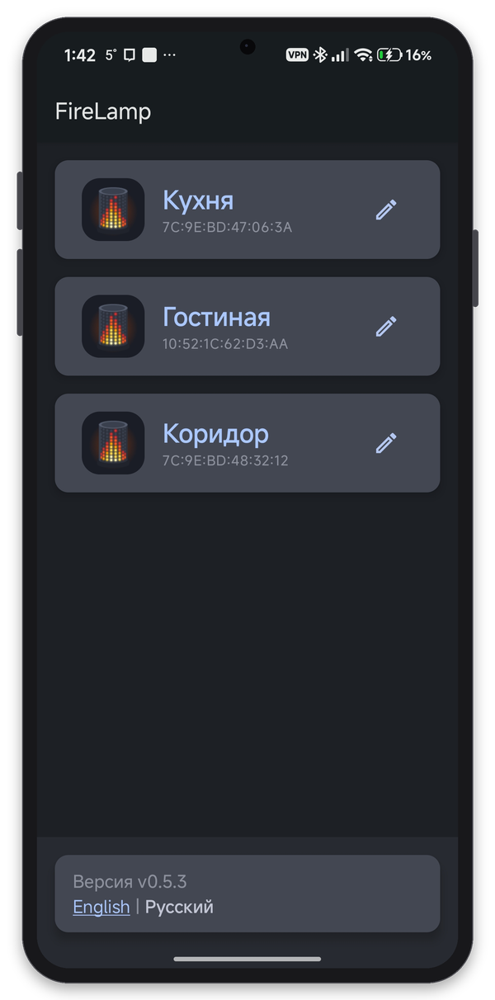
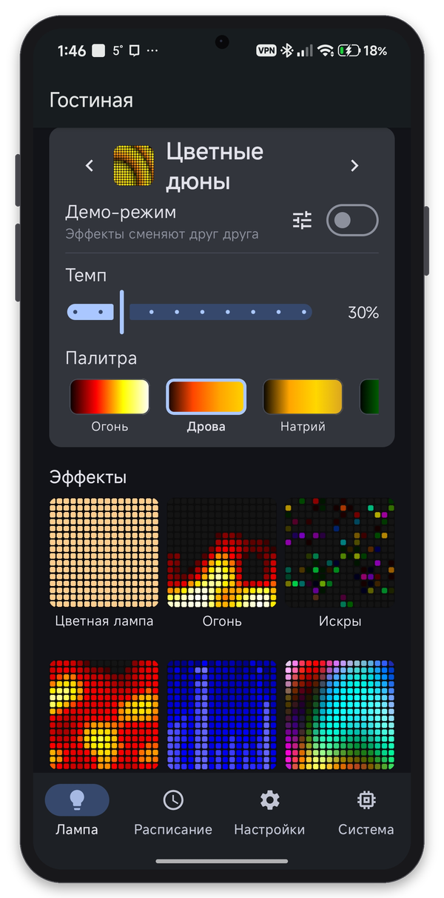
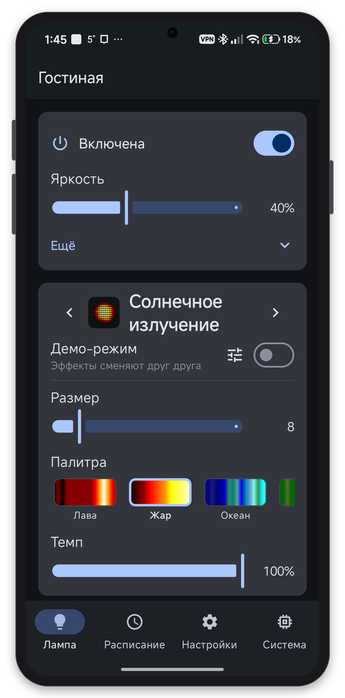
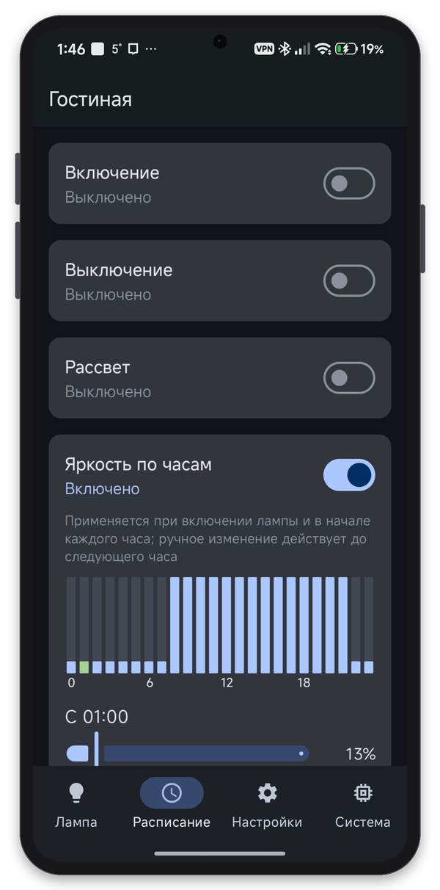
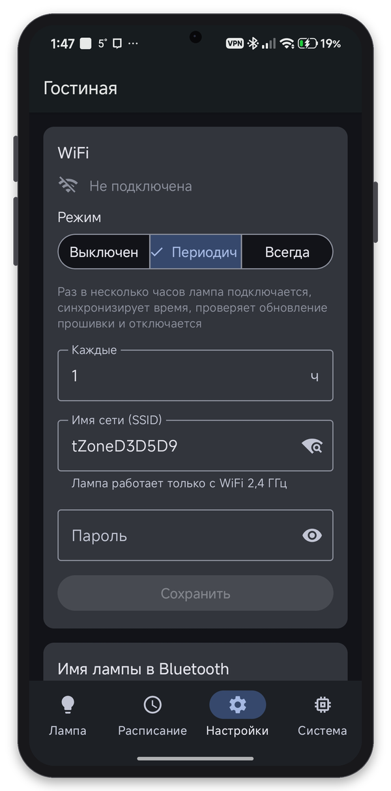
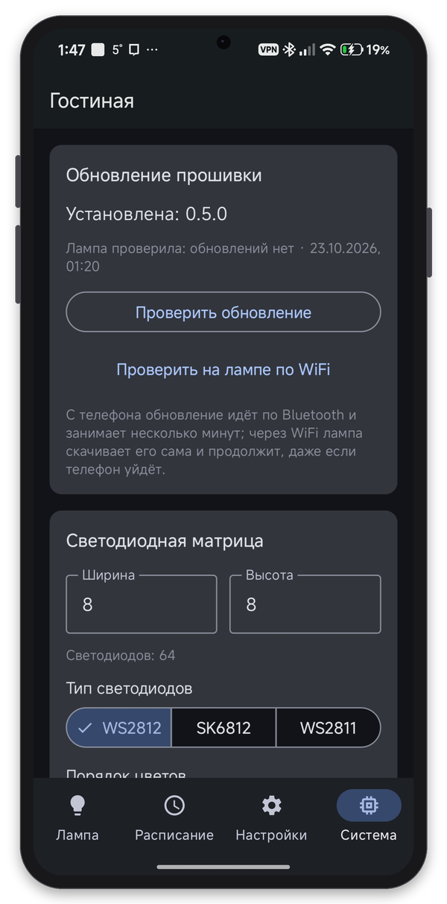

# FireLamp Android

[](https://github.com/golyakoff/FireLamp_Android/releases/latest)


**Русский** | [English](README.en.md)

Приложение для Android, которым управляют «огненной лампой» — светодиодной матрицей на ESP32 /
ESP32-C3 с прошивкой **[FireLamp ESP32](https://github.com/golyakoff/FireLamp_ESP32)**. Работает
по Bluetooth Low Energy: без облака и аккаунтов, WiFi лампе не обязателен.

**[Скачать APK](https://github.com/golyakoff/FireLamp_Android/releases/latest)** ·
[как собрать лампу](https://github.com/golyakoff/FireLamp_ESP32#быстрый-старт) ·
[схемы подключения](https://github.com/golyakoff/FireLamp_ESP32#подключение)

<p align="center">
  
  
  
  
  
  
</p>

## Что умеет

- **Лампы рядом.** Находит лампы поблизости и ту, с которой телефон уже связан; спаривает с
  подсказками, если у лампы закрыто окно спаривания; при обрыве связи переподключается на месте.
- **Лампа.** Включение, яркость, эффекты плиткой с живыми превью (в прошивке 0.10.0 их 45), предыдущий/следующий, демо-режим.
  Параметры эффекта — понятными элементами: цвет на цветовом круге, палитры плитками, режимы
  кнопками, «Темп» в процентах; изменения сразу видны на лампе.
- **Расписание.** Включение и выключение по времени и дням недели, «рассвет» с плавным набором
  яркости и выбранным эффектом, яркость по часам.
- **Настройки.** WiFi лампы (со списком сетей, которые она слышит), имя лампы в Bluetooth, время и
  часовой пояс телефона.
- **Система.** Обновление прошивки, светодиодная матрица (размер, тип, поворот, раскладка со
  схемой ленты, ограничение тока), управление (одна кнопка, четыре кнопки или сенсор, как
  подключены кнопки, пин кнопки), сведения о лампе, перезагрузка и сбросы.
- **Обновление прошивки.** С телефона по Bluetooth (приложение само скачивает релиз и проверяет его)
  или самой лампой через WiFi. Приложение также сообщает о новых версиях самого себя.

Русский и английский языки, переключаются в приложении.

## Установка

1. Скачайте `firelamp-vX.Y.Z-release.apk` из
   [последнего релиза](https://github.com/golyakoff/FireLamp_Android/releases/latest) и установите
   (Android попросит разрешить установку из этого источника).
2. Включите лампу и в течение **2 минут** откройте приложение: лампа `FireLamp-XXXX` появится в
   списке, нажмите на неё и подтвердите спаривание. Если окно спаривания закрылось — сделайте
   **5 кликов** кнопкой лампы (она коротко мигнёт синим) и подключитесь снова.
3. На вкладке «Система» настройте матрицу и кнопки, перезагрузите лампу.

Приложение просит разрешение «Устройства поблизости» (Android 12+) или геолокацию (Android 9–11 —
так Android требует для поиска Bluetooth-устройств). Геолокация на новых версиях нужна, только
если вы попросите подставить WiFi-сеть телефона в настройки лампы.

## Требования

- Android 9 (API 28) или новее с Bluetooth Low Energy
- Лампа с прошивкой [FireLamp ESP32](https://github.com/golyakoff/FireLamp_ESP32) (протокол BLE версии 1)

Приложение работает и со старыми прошивками; новые возможности появляются, когда лампа их
поддерживает:

| Возможность | Прошивка лампы |
|---|---|
| Список WiFi-сетей при настройке | 0.1.5 |
| Выбор пина кнопки | 0.4.3 |
| «Темп» у эффектов без своей скорости | 0.5.0 |
| Блок питания: яркость после просадок, калибровка | 0.9.0 |
| Верховой огонь, Магма, Призмата, Облака, Снегопад | 0.10.0 |

## Сборка

```bash
./gradlew testDebugUnitTest   # unit-тесты на JVM: кодек протокола, часовые пояса, манифест прошивки, эффекты
./gradlew assembleDebug       # debug APK: app/build/outputs/apk/debug/
./gradlew lintDebug
```

Kotlin, Jetpack Compose (Material 3), Hilt,
[Nordic Android BLE library](https://github.com/NordicSemiconductor/Android-BLE-Library), OkHttp/Retrofit,
Coil. Контракт BLE — документы прошивки
[BLE_PROTOCOL.md](https://github.com/golyakoff/FireLamp_ESP32/blob/main/docs/BLE_PROTOCOL.md) и
[APP_INTEGRATION.md](https://github.com/golyakoff/FireLamp_ESP32/blob/main/docs/APP_INTEGRATION.md);
весь формат байтов — в одном месте, `app/src/main/java/net/agolyakov/firelamp/protocol/`.
Архитектура описана в [CLAUDE.md](CLAUDE.md).

Превью эффектов (GIF) берутся при сборке из папки `preview/` прошивки: из соседней копии
репозитория, из `-Pfirelamp.previewsDir` или `$FIRELAMP_PREVIEWS_DIR`; без них приложение скачает
превью с GitHub.

Иконка генерируется: `python3 tools/icon_gen.py app/src/main/res preview.png`.
Скриншоты для README вставляются в рамку телефона: `python3 tools/screenshots/frame.py <папка со скриншотами>`.

## Релизы

Тег `vX.Y.Z` собирает подписанный APK и публикует релиз GitHub с текстом раздела
`# Release X.Y.Z` из [CHANGELOG.md](CHANGELOG.md). Перед этим поднимите `appVersionCode` /
`appVersionName` в `app/build.gradle.kts` и добавьте раздел в CHANGELOG. Теги пушатся по одному:
приложение проверяет обновления по `releases/latest`. Workflow нужны секреты репозитория
`KEYSTORE_BASE64`, `KEYSTORE_PASSWORD`, `KEY_ALIAS` и `KEY_PASSWORD`.
